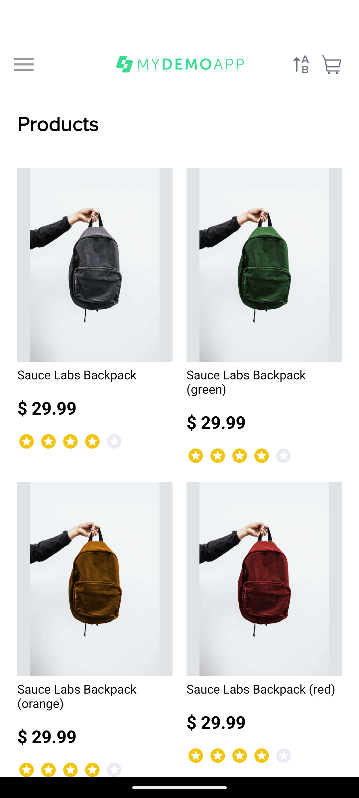
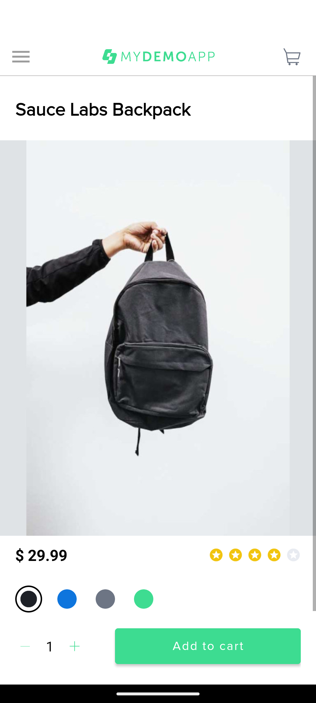
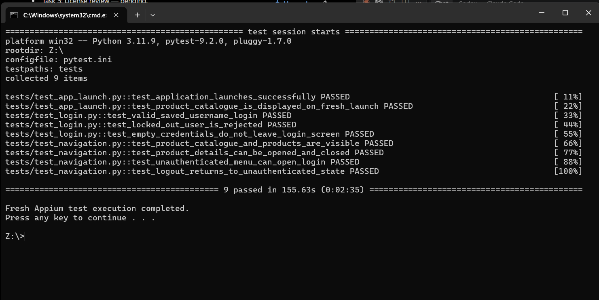

# Android Mobile Automation Framework

Python-based Android UI automation using **Appium**, **Selenium WebDriver**,
**Pytest**, **UiAutomator2**, and the **Page Object Model (POM)**.

> **Application under test:** Sauce Labs My Demo App sample application.  
> This portfolio project does **not** test Atomberg's application.

## Third-Party Materials

Sauce Labs My Demo App is used as the application under test. Its APK and
application assets are third-party materials and are not distributed in this
repository. This repository's MIT License applies only to the original
framework code and project materials authored here; it does not cover the
sample application or its third-party APK, branding, images, UI assets, or
dependencies.

## Overview

This framework demonstrates a maintainable approach to Android UI testing:

- Centralized, environment-configurable Appium driver setup.
- Function-scoped Pytest driver sessions with teardown.
- Page objects that separate screen interactions from test assertions.
- Explicit waits with implicit waits disabled.
- Login, catalogue, product-details, navigation, and logout coverage.
- Failure screenshots captured during failed test call phases.
- Built-in Pytest JUnit XML reporting.

The verified local setup uses a Pixel 6 Android emulator. The framework is
configured for emulator-based execution and does not claim cloud, CI/CD,
parallel, cross-platform, or real-device execution.

## Objectives

- Verify application launch and the initial product catalogue.
- Validate the sample application's supported login states.
- Verify product names, prices, and product-details navigation.
- Exercise the unauthenticated and authenticated navigation menus.
- Demonstrate practical, reusable QA automation skills through a portfolio
  project.

## Technology stack

| Technology | Version or purpose |
|---|---|
| Python | 3.11 |
| Appium Server | 3.9.0 |
| Appium-Python-Client | 6.1.4 |
| Selenium | 4.52.0 |
| Pytest | 9.2.0 |
| UiAutomator2 | Appium Android driver; verified driver 8.7.3 |
| Android Emulator | Pixel 6, Android API 37 in the verified setup |
| Architecture | Page Object Model |

Python dependency versions are pinned in
[requirements.txt](requirements.txt).

## Key features

- `utils/driver_setup.py` centralizes capabilities and configuration.
- `conftest.py` creates and closes one driver session per test.
- `pages/` contains Base, Home, Login, Menu, and Product page objects.
- `tests/` contains application, login, catalogue, and navigation tests.
- `WebDriverWait` provides explicit presence, visibility, and clickability
  waits.
- `full_reset=True` isolates tests by resetting the application per session.
- Failed test call phases produce timestamped PNG screenshots.
- JUnit XML is generated with Pytest; no extra reporting dependency is used.

## Portfolio Screenshots

### Product catalogue



### Product details



### Test execution



## Page Object Model architecture

```text
Test modules
    |
    +-- Page objects (screen actions and locators)
    |       +-- BasePage
    |       +-- HomePage
    |       +-- LoginPage
    |       +-- MenuPage
    |       +-- ProductPage
    |
    +-- conftest.py (driver fixture and failure screenshots)
            |
            +-- utils/driver_setup.py (Appium session configuration)
```

Tests own the workflow assertions. Page objects own the application
interactions and verified locators.

## Project structure

```text
Appium-Mobile-Automation/
├── apps/
│   └── my-demo-app.apk          # Local APK; excluded from Git
├── pages/
│   ├── base_page.py             # Shared explicit-wait helpers
│   ├── home_page.py             # Initial catalogue screen
│   ├── login_page.py            # Login interactions
│   ├── menu_page.py             # Drawer, login, and logout interactions
│   └── product_page.py          # Catalogue and product interactions
├── tests/
│   ├── test_app_launch.py       # Launch and initial-screen tests
│   ├── test_login.py            # Login validation tests
│   └── test_navigation.py       # Catalogue and navigation tests
├── utils/
│   └── driver_setup.py          # Centralized Appium configuration
├── reports/                     # Local generated reports; Git-ignored
├── screenshots/                 # Local failure screenshots; Git-ignored
├── conftest.py                  # Shared fixture and screenshot hook
├── inspect_ui.py                # UI hierarchy inspection utility
├── test_connection.py           # Standalone connection check
├── pytest.ini                   # Pytest configuration
├── requirements.txt             # Pinned Python dependencies
├── .gitignore
└── README.md
```

The APK is not included in the repository. See [APK setup](#apk-setup).

## Automated test scenarios

| # | Scenario | Test |
|---:|---|---|
| 1 | Verify the application launches with the expected package | `test_application_launches_successfully` |
| 2 | Verify the product catalogue is visible after a fresh launch | `test_product_catalogue_is_displayed_on_fresh_launch` |
| 3 | Verify valid login using the sample app's saved user option | `test_valid_saved_username_login` |
| 4 | Verify the displayed locked-out user is rejected with an error | `test_locked_out_user_is_rejected` |
| 5 | Verify empty submission remains on the Login screen | `test_empty_credentials_do_not_leave_login_screen` |
| 6 | Verify product list, titles, and prices | `test_product_catalogue_and_products_are_visible` |
| 7 | Open product details and return with Android Back | `test_product_details_can_be_opened_and_closed` |
| 8 | Navigate from the unauthenticated menu to Login | `test_unauthenticated_menu_can_open_login` |
| 9 | Confirm logout and verify return to Login | `test_logout_returns_to_unauthenticated_state` |

The sample account choices are provided by the application itself. No
real-user credentials or personal information are stored in this project.

## Prerequisites

Install or configure:

1. Python 3.11.
2. Android Studio.
3. Android SDK Platform Tools, including `adb`.
4. An Android emulator. The verified setup uses a Pixel 6 with Android API
   37.
5. Appium Server 3.9.0.
6. The Appium UiAutomator2 driver.
7. An authorized local copy of the Sauce Labs My Demo App APK.

The emulator and Appium server must be running before Pytest execution.

## Windows installation

Open PowerShell and change to the directory where you cloned this repository:

```powershell
Set-Location "<clone-directory>"
```

Create and activate a virtual environment:

```powershell
py -3.11 -m venv venv
.\venv\Scripts\Activate.ps1
```

Install the pinned Python dependencies:

```powershell
python -m pip install -r requirements.txt
```

If PowerShell prevents activation, use the virtual-environment interpreter
directly:

```powershell
.\venv\Scripts\python.exe -m pip install -r requirements.txt
```

## Android SDK and emulator setup

Set the Android SDK variables for the current PowerShell session. Replace the
placeholder with the SDK path on your machine:

```powershell
$env:ANDROID_HOME = "C:\Users\<your-user>\AppData\Local\Android\Sdk"
$env:ANDROID_SDK_ROOT = $env:ANDROID_HOME
$env:Path += ";$env:ANDROID_HOME\platform-tools;$env:ANDROID_HOME\emulator"
```

To persist the variables for future terminals, use the actual SDK path and
open a new PowerShell window afterward:

```powershell
setx ANDROID_HOME "C:\Users\<your-user>\AppData\Local\Android\Sdk"
setx ANDROID_SDK_ROOT "C:\Users\<your-user>\AppData\Local\Android\Sdk"
```

Start the emulator from Android Studio's Device Manager, then verify ADB:

```powershell
adb version
adb devices
adb shell getprop ro.build.version.release
adb shell getprop ro.build.version.sdk
```

The default device configuration is:

| Setting | Default |
|---|---|
| Device name | `Pixel_6` |
| UDID | `emulator-5554` |
| Verified Android API | `37` |

The device should appear in `adb devices` with the state `device`.

## Appium server and UiAutomator2 setup

Start Appium Server in a separate PowerShell window:

```powershell
appium
```

The default server URL is:

```text
http://127.0.0.1:4723
```

Install UiAutomator2 if it is not already installed:

```powershell
appium driver install uiautomator2
appium driver list --installed
```

The verified UiAutomator2 driver version is 8.7.3. Appium Server and the
emulator must be running before starting the tests.

## APK setup

The application under test is the Sauce Labs My Demo App sample application:

```text
Package: com.saucelabs.mydemoapp.android
```

The APK is excluded from Git because redistribution permission has not been
verified. Obtain an authorized copy separately; do not assume that a publicly
available APK may be redistributed.

The driver default is a repository-relative path:

```text
apps\my-demo-app.apk
```

If the APK is stored elsewhere, configure its local path:

```powershell
$env:ANDROID_APP_PATH = "C:\authorized\path\my-demo-app.apk"
```

The package can be overridden when required:

```powershell
$env:ANDROID_APP_PACKAGE = "com.saucelabs.mydemoapp.android"
```

## Driver configuration

The actual environment variables and defaults in
`utils/driver_setup.py` are:

| Variable | Default |
|---|---|
| `APPIUM_SERVER_URL` | `http://127.0.0.1:4723` |
| `ANDROID_DEVICE_NAME` | `Pixel_6` |
| `ANDROID_UDID` | `emulator-5554` |
| `ANDROID_PLATFORM_VERSION` | Empty; omitted unless set |
| `ANDROID_APP_PACKAGE` | `com.saucelabs.mydemoapp.android` |
| `ANDROID_APP_PATH` | Project root plus `apps\my-demo-app.apk` |

Example PowerShell configuration:

```powershell
$env:APPIUM_SERVER_URL = "http://127.0.0.1:4723"
$env:ANDROID_DEVICE_NAME = "Pixel_6"
$env:ANDROID_UDID = "emulator-5554"
$env:ANDROID_PLATFORM_VERSION = "17"
$env:ANDROID_APP_PACKAGE = "com.saucelabs.mydemoapp.android"
$env:ANDROID_APP_PATH = "C:\authorized\path\my-demo-app.apk"
```

## Running the tests

With the emulator running, the APK path configured, and Appium Server
listening:

```powershell
Set-Location "<clone-directory>"
.\venv\Scripts\Activate.ps1
python -m pytest -v
```

The `pytest.ini` configuration:

- Discovers tests under `tests`.
- Enables verbose output.
- Uses short tracebacks.
- Enables live INFO-level logging.

Each test receives a new Appium session. The fixture closes the session with
`quit()` after the test, and the driver performs a full application reset for
each session.

## Reports and failure screenshots

Generate a JUnit XML report using Pytest's built-in reporting option:

```powershell
python -m pytest -v --junitxml=reports/test-results.xml
```

The generated report is written to `reports/test-results.xml`. Reports and
screenshots are generated artifacts and are excluded from Git.

When a test fails during its call phase, `conftest.py` captures a PNG under
`screenshots/` and logs the generated path. Screenshots are not captured for
every test and may contain application state, so review them before sharing
publicly.

The latest verified execution result was:

```text
9 passed in 155.63 seconds
```

This result was recorded in one configured environment and is not a guarantee
that the suite will pass on every machine.

## Troubleshooting

### Appium connection failure

Confirm that the server is running:

```powershell
appium
```

If it uses another URL, set `APPIUM_SERVER_URL`.

### Device is not detected

```powershell
adb devices
```

Start the emulator, wait for the `device` state, and set `ANDROID_UDID` to
the actual identifier if it differs from the default.

### `adb` is not recognized

Verify `ANDROID_HOME`, `ANDROID_SDK_ROOT`, and the `platform-tools` entry in
`PATH`. Open a new PowerShell window after using `setx`.

### UiAutomator2 is unavailable

```powershell
appium driver install uiautomator2
appium driver list --installed
```

### APK cannot be found

Set `ANDROID_APP_PATH` to an authorized local APK:

```powershell
$env:ANDROID_APP_PATH = "C:\authorized\path\my-demo-app.apk"
```

### Locators cannot be found

Confirm that the APK is the expected Sauce Labs My Demo App build. The
locators were based on the inspected UI hierarchy for this sample
application and are not intended for Atomberg or another application.

## Limitations and future improvements

Current limitations:

- Targets the Sauce Labs My Demo App sample application only.
- Requires an authorized local APK.
- The verified setup uses an Android emulator only.
- No real-device or cloud-device execution is implemented.
- No parallel execution or cross-platform test matrix is configured.
- No CI/CD workflow is included.
- JUnit XML is supported; an HTML reporting plugin is not included.
- Screenshots are captured only for failed test call phases.

Possible future improvements:

- Add a reviewed HTML reporting dependency if required.
- Add CI validation for compilation and Pytest collection.
- Document an emulator-based CI strategy.
- Add configuration validation and clearer startup diagnostics.
- Expand product and navigation coverage from verified UI behavior.
- Add repository contribution and issue-management documentation.

## Author and project information

This is a portfolio project demonstrating Android UI automation and
maintainable Pytest framework design.

**Radhika Baigaru**

- GitHub: [https://github.com/iradhika787](https://github.com/iradhika787)
- LinkedIn: [https://linkedin.com/in/baigaru-radhika](https://linkedin.com/in/baigaru-radhika)

The original framework code is separate from the Sauce Labs sample
application, APK, third-party Python packages, and any application assets.
Review the applicable licenses before redistributing those third-party
materials.
